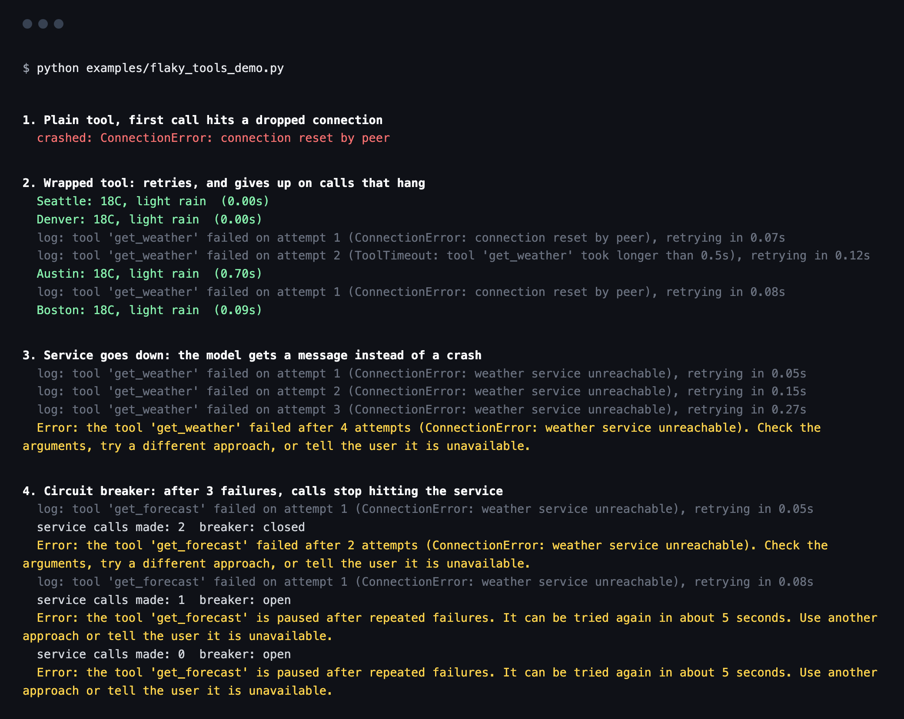

# sturdytools

Retries, timeouts, rate limits and circuit breakers for the tools an AI agent calls.

[](https://pypi.org/project/sturdytools/)
[](https://github.com/ai-with-md/sturdytools/actions/workflows/tests.yml)


An agent is only as reliable as its tools. A search API that drops one request in fifty, a database that hangs, or a service that hits its rate limit can end an agent run, or put a raw stack trace in front of the user. Most of these failures are temporary, and the rest can be handled if the model gets a clear message it can act on.

sturdytools is one decorator that handles this for any Python function, sync or async, with no dependencies.

```python
from sturdytools import sturdy

@sturdy(timeout=10, retries=3, rate_limit="5/s", on_error="message")
def search_orders(customer_id: str) -> list:
    """Find recent orders for a customer."""
    return orders_api.search(customer_id)
```

If the API drops a connection, the call is retried with backoff. If it hangs, the attempt is abandoned after 10 seconds. If it still fails after 3 retries, the model gets a short message instead of an exception:

```
Error: the tool 'search_orders' failed after 4 attempts (ConnectionError: connection reset by peer).
Check the arguments, try a different approach, or tell the user it is unavailable.
```

[](https://github.com/ai-with-md/sturdytools/blob/main/examples/flaky_tools_demo.py)

## Install

```bash
pip install sturdytools
```

Python 3.9 or newer. No other packages are needed.

## What it does

| Option | What it does | Default |
|---|---|---|
| `timeout` | Seconds before one attempt is abandoned with `ToolTimeout` | none |
| `retries` | Extra attempts after the first one fails | 0 |
| `retry_on` | Errors that count as temporary. Only these are retried | `Exception` |
| `backoff`, `max_backoff` | Wait before the first retry, doubling each time with jitter, up to the cap | 0.5s, 8s |
| `rate_limit` | `"5/s"`, `"60/min"`, `"1000/hour"`, or a shared `RateLimiter` | none |
| `breaker` | A `CircuitBreaker`, or `True` for one per tool | none |
| `fallback` | Value to return when the tool gives up. If callable, it gets the tool's arguments | none |
| `on_error` | `"raise"`, `"message"`, or your own function `(name, error, attempts)` | `"raise"` |
| `on_retry` | Called as `(attempt, error, delay)` before each retry, for logging or metrics | none |

Each call goes through the same steps:

1. If the circuit breaker is open, stop right away.
2. Wait for the rate limiter.
3. Run the tool with the time limit.
4. If it raised a temporary error and retries are left, wait and go back to step 1.
5. Otherwise use the fallback, return a message, or raise, depending on the settings.

The wrapper keeps the original function name, docstring and signature, which is what agent frameworks read to build the tool description for the model. Put `@sturdy` closest to the function, under your framework's tool decorator.

## Works with MCP servers and LangChain

The wrapper keeps the function's name, docstring and signature, so frameworks build the same tool description as before. Put `@sturdy` under the framework's decorator, closest to the function:

```python
from mcp.server.mcpserver import MCPServer
from sturdytools import sturdy

server = MCPServer("weather")

@server.tool()
@sturdy(timeout=10, retries=2, on_error="message")
async def get_weather(city: str) -> str:
    """Current weather for a city."""
    ...
```

```python
from langchain_core.tools import tool
from sturdytools import sturdy

@tool
@sturdy(timeout=10, retries=2, rate_limit="5/s", on_error="message")
def search_orders(customer_id: str) -> list:
    """Find recent orders for a customer."""
    ...
```

Checked with mcp 2.3 and langchain-core 1.8, for sync and async tools: the tool schema and description are unchanged, retries happen inside the tool call, and a tool that gives up returns the error message to the model as its result.

## Sharing limits and breakers across tools

Several tools often call the same API. Give them one rate limiter and one breaker, so they respect the same limit and stop together when the service is down.

```python
from sturdytools import CircuitBreaker, RateLimiter, sturdy

crm_limit = RateLimiter.parse("10/s")
crm_breaker = CircuitBreaker(failure_threshold=5, reset_after=30)

@sturdy(retries=2, rate_limit=crm_limit, breaker=crm_breaker, on_error="message")
def get_account(account_id: str) -> dict:
    ...

@sturdy(retries=2, rate_limit=crm_limit, breaker=crm_breaker, on_error="message")
def list_contacts(account_id: str) -> list:
    ...
```

After 5 temporary failures in a row, both tools stop calling the service for 30 seconds and tell the model it is paused. Then one trial call goes through. If it works, normal calls resume.

## Async tools

The same decorator works on `async def` functions. Timeouts cancel the task, and the rate limiter and retries wait without blocking the event loop.

```python
@sturdy(timeout=5, retries=2, fallback=lambda city: "weather unavailable")
async def get_weather(city: str) -> str:
    async with httpx.AsyncClient() as client:
        response = await client.get(WEATHER_URL, params={"q": city})
        response.raise_for_status()
        return response.text
```

## Choosing what to retry

Retrying everything is rarely right. If the model passed a bad argument, retrying the same call wastes time and money. Limit retries to errors that are actually temporary:

```python
@sturdy(retries=3, retry_on=(ConnectionError, TimeoutError), on_error="message")
def lookup_invoice(invoice_id: str) -> dict:
    ...
```

Here a `KeyError` for an unknown invoice goes straight back to the model as a message, so it can correct itself, and it does not count against the circuit breaker.

## Try it

```bash
python examples/flaky_tools_demo.py
```

The [demo](https://github.com/ai-with-md/sturdytools/blob/main/examples/flaky_tools_demo.py) uses a fake weather service that drops connections, hangs, and then goes down, and prints what a plain tool and a wrapped tool do in each case. No API keys are needed.

## How it compares

- **[tenacity](https://github.com/jd/tenacity)** and **[stamina](https://github.com/hynek/stamina)** are excellent general retry libraries. If retries are all you need, use one of them.
- sturdytools is narrower and aimed at agent tools: timeouts, retries, rate limits, a circuit breaker and a fallback in one decorator, plus an error message written for the model, so a failing tool becomes something the agent can reason about instead of a crash.
- Agent frameworks have their own retry options (LangChain's `with_retry`, retry policies on LangGraph nodes). Those retry a whole step. sturdytools works on the single tool function, so it behaves the same in any framework, or in none.

## Limits

- Python cannot stop a running thread. When a sync tool times out, the caller gets `ToolTimeout` right away, but the original call keeps running in a background thread until it finishes on its own. For tools that can hang for a long time, prefer async, where the task is cancelled, or set a timeout in the client library as well.
- Rate limits and breakers live in memory, per process. Several workers calling the same API each keep their own count.

## Development

```bash
python -m venv .venv
source .venv/bin/activate
pip install -e ".[dev]"
pytest
```

Tests run on Python 3.10, 3.12 and 3.13 on every push.

## License

MIT
